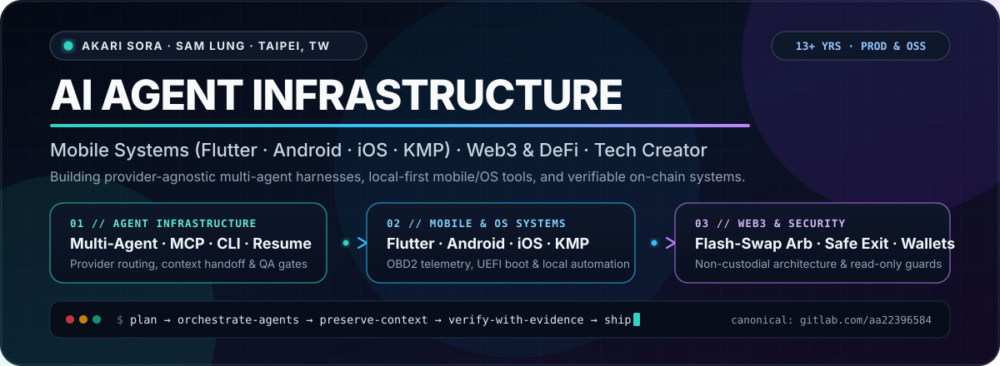

  

  
  
  
  
  

---

### ⚡ About

- **Engineering (13+ yrs)** — Senior Software Engineer building **AI agent infrastructure** (multi-agent orchestration, MCP servers, CLI harnesses, context recovery, verification gates), **cross-platform mobile systems** (`Flutter`, `Android`, `iOS`, `KMP`), and **Web3 / DeFi products** (non-custodial wallets, flash-swap arbitrage, safe-exit tooling).
- **Tech Writing & Community** — Publishing deep-dive engineering breakdowns, agentic workflow benchmarks, and Web3/AI field notes on [**Threads (@sam_lung2077)**](https://www.threads.com/@sam_lung2077), [**Facebook**](https://www.facebook.com/shanglol), and [**LinkedIn**](https://www.linkedin.com/in/sam-lung-86ab62191/).
- **Canonical Repositories** — *GitHub hosts read-only mirrors and selected open-source tools. Active development, CI/CD, issues, and releases live on [**GitLab (@aa22396584)**](https://gitlab.com/aa22396584).*

---

### 🚀 Featured Open-Source Systems

| System | Focus | Stars |
| :--- | :--- | :---: |
| [**aave-oracle-lag-arb**](https://github.com/akari-sora/aave-oracle-lag-arb) | Solidity Uniswap V3 flash-swap contract + multi-chain TypeScript bot (`Ethereum`, `Arbitrum`, `Base`, `Optimism`) + AI agent skill for Aave V3 oracle-lag arbitrage. |  |
| [**synology-nas-cli**](https://github.com/akari-sora/synology-nas-cli) | Zero-dependency Python CLI + MCP server for Synology DSM 7 — one-command ransomware audit and automated remediation for AI agents. |  |
| [**googlebook-anywhere**](https://github.com/akari-sora/googlebook-anywhere) | Turn Google's official Googlebook (`lapis`, Android 17 desktop) recovery image into a bootable x86-64 UEFI USB image. |  |
| [**telltale**](https://github.com/akari-sora/telltale) | Open-source Flutter OBD2 vehicle telemetry, live PID gauges, and diagnostics app for ELM327 adapters. |  |
| [**wallet-guardian**](https://github.com/akari-sora/wallet-guardian) · [**wallet-exit-kit**](https://github.com/akari-sora/wallet-exit-kit) | Read-only multi-chain wallet monitor, approval/revoke simulation cards, and emergency exit workbench for AI agents (zero private keys). |  |
| [**gitlab-mobile**](https://github.com/akari-sora/gitlab-mobile) | Mobile-first Flutter client for GitLab (`Android` / `iOS`) with merge-request workflows and pipeline inspection. |  |

> **More on GitLab (`@aa22396584`)**: [`oh-my-grok`](https://gitlab.com/aa22396584/oh-my-grok) · [`oh-my-agy`](https://gitlab.com/aa22396584/oh-my-agy) · [`resume-skills`](https://gitlab.com/aa22396584/resume-skills) · [`termux-flutter-wsl`](https://gitlab.com/aa22396584/termux-flutter-wsl) · [`charge-pilot`](https://gitlab.com/aa22396584/charge-pilot)

---

### 🛠️ Tech Stack

  

| Domain | Core Technologies |
| :--- | :--- |
| **AI Agent & Dev Infra** | Multi-Agent Orchestration, MCP Servers, CLI Harnesses, Context/Session Portability, Automated QA Gates |
| **Mobile & OS** | Flutter, Dart, Android (Kotlin / Jetpack Compose), iOS (Swift), Kotlin Multiplatform, Wear OS, UEFI / ARM64 |
| **Web3 & DeFi** | Solidity, EVM / Foundry, Non-Custodial Wallet Architecture, Flash-Swap Arbitrage, Bitcoin, Solana, TRON |
| **Backend & Cloud** | TypeScript, Python, Go, Rust, C/C++, Linux, Docker, GitLab CI, Firebase, GCP, AWS |
